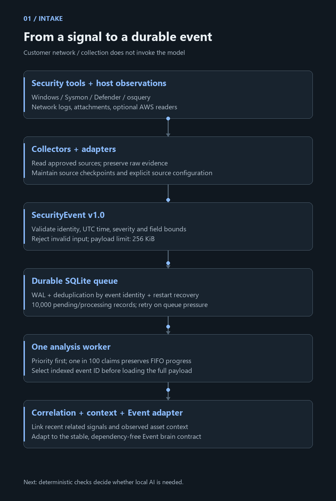
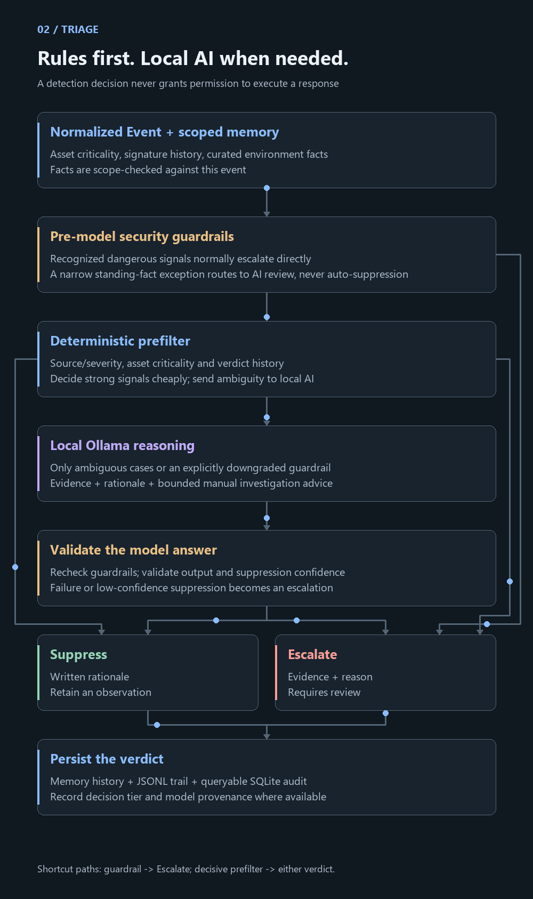
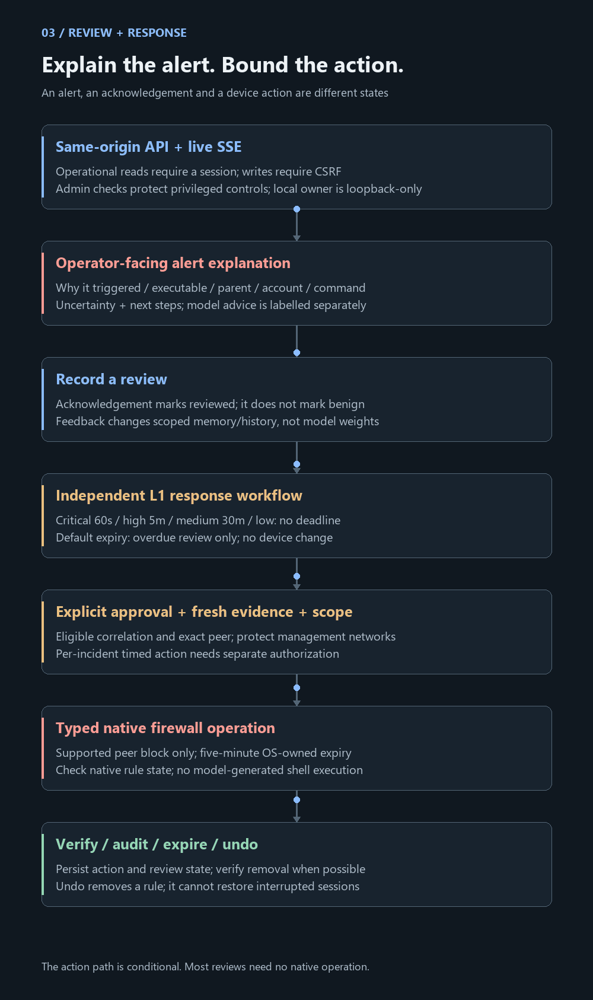
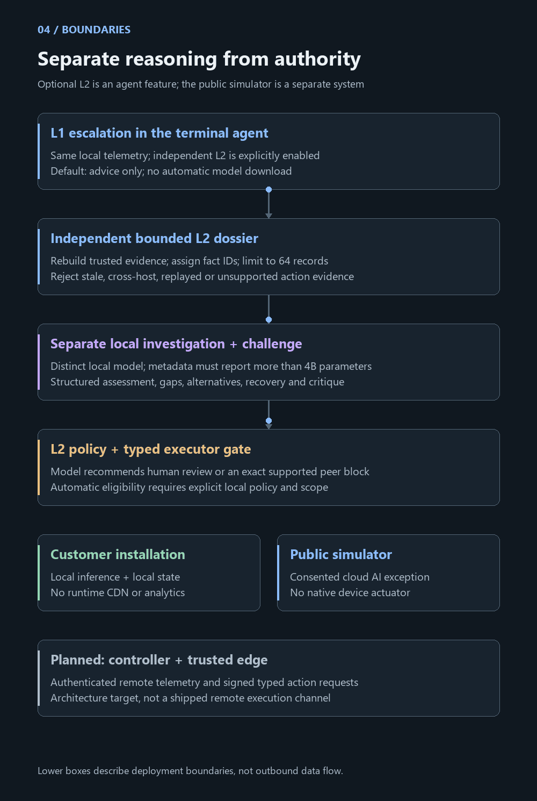

# Arbiter AI: follow an event through the system

**A vertical, animated architecture walkthrough of the implemented product.**

Read from top to bottom: collect a signal, preserve its evidence, decide whether
it needs attention, explain the decision, and authorize a bounded response only
when policy allows it. The animation shows architectural flow, not live traffic,
measured latency, or an attack simulation. All labels remain visible.

**Prefer no motion? [Read the identical still-diagram edition](architecture/STILL.md).**
The explanations below also provide a complete text equivalent. The GIF and SVG
assets live in this repository; no external diagram service or runtime script is
needed to view this document on GitHub.

Jump to [intake](#1-intake-preserve-the-evidence),
[triage](#2-triage-decide-with-evidence),
[review and response](#3-review-explain-before-asking-for-action), or
[system boundaries](#4-boundaries-keep-reasoning-and-authority-separate).

## 1. Intake: preserve the evidence

### Sources produce observations, not verdicts

Host tools and collectors read Windows event logs, Sysmon, Defender findings,
osquery, supported network logs, device attachments, and local process context.
Optional AWS readers retrieve configured CloudTrail or GuardDuty sources through
the optional SDK. These integrations have different permissions, coverage and
delivery guarantees; listing a source does not imply that it is enabled or that
its transport has been validated in every environment.

Collection is outside the triage engine. A collector does not ask the model to
classify an event, run a response, or grant itself trust. The registry tracks
enabled sources and checkpoints. Local discovery respects explicitly disabled
sources. [Connector reference](CONNECTORS.md) · [tool integration](SECURITY_TOOL_INTEGRATIONS.md).

### Normalize once, retain the original

Adapters produce `SecurityEvent` v1.0: event identity, source, UTC timestamps,
host, account, severity, network/process/file fields and bounded metadata.
Validation rejects unsupported schema versions, invalid values and events above
256 KiB. The original payload remains available for inspection.

Source provenance matters. Imported data cannot make itself a trusted native
security finding by supplying a convincing-looking field. Event text and model
output are evidence to inspect, never instructions to execute.

### Queue durably, select cheaply

The SQLite ingestion store uses WAL, identity deduplication and persistent
checkpoints. Its pending/processing capacity defaults to 10,000 records. Queue
pressure is visible: supported checkpointed collectors retry and HTTP ingestion
can return 429. UDP syslog can lose packets; it has no reliable retry guarantee.

One analysis worker claims events. Urgency normally wins; one in 100 claims uses
FIFO ordering so older work can progress. Indexed ID selection loads only the
chosen event's large payload. This reduces time spent holding the shared database
lock; it does **not** make the queue unlimited or eliminate inference backlogs.

On restart, interrupted processing returns to pending. A recorded audit verdict
can be reused. Delivery is at least once: a crash between history and audit writes
can duplicate memory history. Arbitrary failed events are not silently retried.

### Add context before entering the brain

The worker updates observed assets, correlates a bounded recent event window,
and supplies related-event IDs. It adapts the normalized record to the stable
`Event` contract in `arbiter/schema.py`. Observed inventory is different from
curated business criticality or an administrator-approved environment fact.

**Code:** [collectors](../arbiter/ingestion/collectors),
[normalization](../arbiter/ingestion/schema.py),
[queue](../arbiter/ingestion/store.py),
[worker](../arbiter/ingestion/pipeline.py),
[correlation](../arbiter/ingestion/correlation.py).

## 2. Triage: decide with evidence

The central path expands an ambiguous event's journey. The outside shortcut
arrows show direct decisions: a guardrail escalation skips the prefilter and
model; a decisive prefilter skips the model and its answer check.

### Guardrails establish the review floor

Before model inference, code checks recognized classes such as credential access,
privilege expansion, download-and-execute, integrity changes, exfiltration,
dangerous system-tool use, ransomware patterns and trusted high-priority findings.
A match normally returns a guardrail escalation immediately, with a reason code.

There is a narrow implemented exception: a standing environment fact explicitly
naming the host and dangerous marker can route certain guardrail matches to
model review. It cannot suppress the event by itself or send it to cheap
prefilter suppression. Other guardrails still apply.

### Spend inference only on ambiguity

The prefilter combines severity, asset criticality and verdict history. Trusted
routine profiles can be handled cheaply; strong suspicious signals escalate
without a model call. An unfamiliar or ambiguous event goes to local reasoning.
Low severity alone is insufficient justification for suppression.

The model receives bounded context and scope-checked facts. A fact about one
process, account or time window must not explain unrelated activity. Learning
is stored context and reviewed history; Arbiter does not fine-tune model weights.

### Validate the answer rather than trusting fluent prose

Local Ollama returns a proposed decision, confidence, rationale, evidence and
optional bounded investigation steps. The parser validates the decision and
finite confidence. The engine rechecks guardrails. Suppression confidence below
0.7 becomes an escalation; model failure also escalates by policy.

The model cannot invoke a shell or authorize a device response. A plausible
explanation is not proof. Larger models and code-checked citations still need
evaluation against real operating conditions.

### Store an auditable decision

An escalation carries evidence; a suppression carries a written rationale.
Decisions update memory history and the JSONL trail; the worker persists a
queryable audit row and telemetry analysis. Tier and available backend/model
provenance distinguish rule decisions, real inference, test heuristics and
policy fallbacks. Shadow-mode output is recorded as such.

**Code:** [engine](../arbiter/triage.py),
[guardrails](../arbiter/guardrails.py),
[prefilter](../arbiter/prefilter.py), [facts](../arbiter/facts.py),
[local model adapter](../arbiter/llm.py), [memory](../arbiter/memory.py),
[audit store](../arbiter/store.py).

## 3. Review: explain before asking for action

### The dashboard reads through an API

The React dashboard uses one API client. Operational APIs require a session;
state-changing requests use double-submit CSRF protection. Privileged controls
check the administrator role. The explicitly configured local-owner mode is
restricted to loopback and local Host/Origin checks. SSE publishes new audit
verdicts, while event views query the durable read model.

The frontend never invokes the triage engine directly. Static assets, fonts and
scripts are self-hosted. There is no runtime CDN, analytics or telemetry service
in the customer dashboard.

### An alert must answer four questions

1. **What triggered?** The recorded decision and, for the system-tool guardrail,
   the binary and command markers actually found in the event text.
2. **Where did it originate?** Executable, parent executable, account, command
   and parent command when recorded; missing values are explicit.
3. **What remains unknown?** Initiating application, authorization, provenance,
   signature verification or other evidence gaps.
4. **What should I do?** Bounded manual investigation steps, labelled as model
   advice or policy guidance rather than executable authority.

For example, a `conhost.exe` event whose parent PowerShell command contains
Arbiter's inventory script can explain that `-nop` matched inside `-NoProfile`.
The matching script is a benign-origin clue; it does not prove who launched it
or automatically bypass security checks. Historical telemetry receives this
read-only explanation without rewriting the stored verdict.

### Review is separate from classification and execution

Acknowledgement records who reviewed an audit row. It does not mark it benign,
kill a process, or remove a rule. Confirm/overrule feedback affects matching
history; signature-wide feedback can cover more than the individual row.
Recommended steps are advisory prose and are never parsed into shell commands.

### Deadlines do not create authority

An independent L1 scheduler persists review cases. Default windows are critical
60 seconds, high five minutes, medium 30 minutes, and low with no automatic
deadline. Severity comes from source severity and deterministic findings, not
model confidence. Default expiry marks a case overdue without changing a device.

An administrator can explicitly approve a supported temporary response or enroll
one eligible incident for a timed peer block. Timed execution requires fresh,
independently supported evidence, an unchanged exact target, permitted scope,
protected management/service networks, capacity and native checks. Stale evidence
or a failed check requires human review. The recommendation never authorizes
itself. Deferral, rejection and emergency stop are persisted separately.

### Execute narrowly, then verify

Supported native peer blocks use a fixed typed operation with a five-minute,
OS-owned expiry. Native rule checks and removal checks are recorded. Windows
firewall and Linux nftables support differ by runtime and scope; a verified rule
does not establish that every attacker flow was stopped.

Undo removes the relevant rule where supported; it cannot restore interrupted
connections or reverse downstream effects. Expiry due and verified cleanup are
different states. No general-purpose remote shell is exposed by the model.

**Code:** [API](../arbiter/api/server.py), [IAM](../arbiter/iam.py),
[alert explanation](../arbiter/ingestion/recommendations.py),
[event drawer](../frontend/src/components/EventPanel.tsx),
[response workflow](../arbiter/ingestion/response_workflow.py),
[native protection](../arbiter/ingestion/protection.py),
[scope](../arbiter/ingestion/containment.py).

## 4. Boundaries: keep reasoning and authority separate

### Optional L2 belongs to the terminal agent

L2 is off by default and explicitly configured with a distinct local model.
Metadata must report more than four billion parameters; no model is downloaded
automatically. It has independent inference transport, evidence selection,
investigation, challenge and recommendation validation. It does not reuse L1's
model engine or accept L1 prose as action proof.

The bounded dossier uses up to 64 local records and code-assigned fact IDs.
Evidence checks reject stale, untrusted, duplicate, replayed and cross-host action
support. L2 returns assessment, evidence, gaps, recommendation, alternatives,
recovery and urgency. Its action vocabulary is human review or the supported
exact peer block. Advice-only is the default.

Unattended action needs explicit local policy and containment scope. A supported
critical deterministic fast path can bypass inference queues while preserving
the policy and executor gates; deeper review follows. A contradictory follow-up
is recorded and can stop a pending recommendation. This is a separate agent
workflow, not an automatically enabled second dashboard model.

### Customer installation and public demonstration are separate

| Boundary | Implemented behavior |
|---|---|
| Customer inference | Local Ollama; cloud model aliases rejected. No external inference calls. |
| Optional AWS acquisition | Explicit source integration; contacts configured AWS APIs to retrieve telemetry. This is different from cloud inference. |
| Local Demo & Replay | Isolated state and simulated responses; no native actuator. |
| Public site simulator | Separately authorized cloud-AI exception with consent for uploaded samples; server-only credentials and simulated response controls. |
| Public landing | Static copy; no customer verdicts, hosts, counts or authenticated API calls. Off by default in customer installs. |
| Packaging | Readable Python zipapp + bundled dashboard; boot service owns lifecycle and preserves databases on upgrade. |

### Planned remote architecture is not a shipped channel

The [controller + trusted edge design](BREACH_CONTAINMENT_ARCHITECTURE.md)
describes authenticated remote telemetry, signed typed action requests and
edge enforcement. It is a target architecture. The current local agent and its
native adapters do not establish that the distributed controller/edge channel
or fleet-wide containment has shipped or been validated.

**Code:** [terminal agent](../arbiter/agent.py), [L2 engine](../arbiter/l2.py),
[dossier](../arbiter/l2_evidence.py), [L2 policy](../arbiter/l2_workflow.py),
[L2 validation](../arbiter/l2_guardrails.py),
[public demo backend](../arbiter/site_cloud.py), [installer](../arbiter/install).

## State ownership at a glance

| State | Owner | Why it is separate |
|---|---|---|
| Raw/normalized events, checkpoints, queue, observed assets | Ingestion SQLite store | Collection and recovery do not depend on the model. |
| Assets, scoped facts, verdict history, feedback | Memory SQLite store | Context can be inspected; no weight training is hidden. |
| Verdicts, reviewer identity, IAM/action audit records | Audit SQLite store + JSONL trails | Decisions and operator changes remain attributable. |
| Accounts, roles, sessions and persisted signing secret | IAM store + local secret | Authentication survives restart without exposing data publicly. |
| Review cases, deadlines, stop state, action records | Response workflow tables in local state | Inference delays do not own authority or erase deadlines. |
| Demo state | Isolated local stores or browser simulation | Demonstrations cannot act on the monitored device. |

## What the diagrams do not promise

This is a pre-release implementation map, not a capacity or security certification.
One worker and bounded queues can accumulate backlog; UDP is lossy; correlation
windows can miss late signals. Native rule verification is narrower than proof
of breach containment. Real-model quality, production-scale delivery and remote
fleet enforcement require their own validation. See
[ingestion limits](INGESTION_ARCHITECTURE.md), [L1 response](L1-RESPONSE.md),
[L2 response](L2-RESPONSE.md), and [validation notes](AGENT-LIVE-VALIDATION.md).

## Maintain this walkthrough

Diagram content and rendering live in
[`tools/render_architecture.py`](../tools/render_architecture.py). Run it with
Python and Pillow installed locally to rebuild the repository-owned GIF, PNG
and SVG assets. Pillow is a documentation build tool, not an Arbiter runtime
dependency. The renderer downloads nothing. Update the explanations and still
edition alongside the diagrams when an implementation boundary changes.
