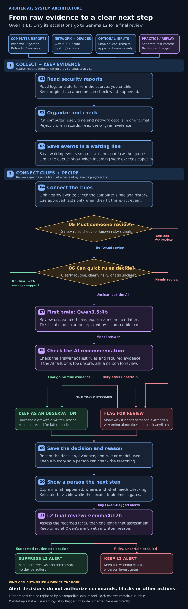
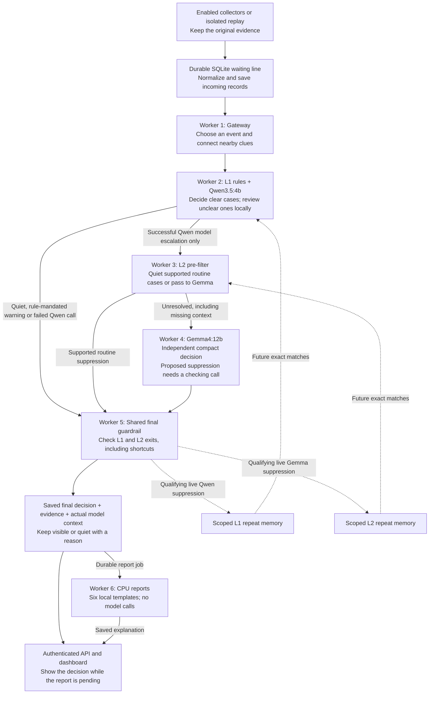

# Arbiter AI — current architecture and project design

Updated 20 November 2026. **Qwen3.5:4b is L1; Gemma4:12b is L2.** Five
decision workers share bounded queues. A separate sixth CPU worker prepares
reports from saved decisions. This describes the published source; existing
installations need an updated build and explicit L2 configuration.

Implementation source:
[`codex/ait-ads-triage-hardening`](https://github.com/Haryshwa29/Arbiter-AI/tree/codex/ait-ads-triage-hardening).
The homepage documentation describes this published branch; it does not imply
that older releases or the `main` application code include the update.

[Latest measured progress](https://github.com/Haryshwa29/Arbiter-AI/blob/90798fe744d1b96ddfaa0fcab3f1412b7fcbf9c6/docs/PROGRESS-2026-11-20.md) ·
[Full report and raw evidence](https://github.com/Haryshwa29/Arbiter-AI/blob/90798fe744d1b96ddfaa0fcab3f1412b7fcbf9c6/evals/2026-11-20-20k-checkpoint/README.md) ·
[Plain-English walkthrough](https://github.com/Haryshwa29/Arbiter-AI/blob/90798fe744d1b96ddfaa0fcab3f1412b7fcbf9c6/docs/ARCHITECTURE-WALKTHROUGH.md)

## The impact behind this design

The latest measured checkpoint quieted **89.95%** of unannotated records,
compared with **57.52%** in the initial published run. L2 removed **496 of 767
unannotated L1 warnings — 64.67%**, compared with **0.35%** initially. The whole
pipeline retained **17,304 of 17,305 attack-labelled records — 99.994%**.
Most attacks were repeated scans handled by rules; five reached the models,
and four stayed flagged. Unannotated records are not independently certified benign.

The five-worker checkpoint also exposed long L2 waits, invalid evidence replies
and one missed account/session attack. The new compact-reply and CPU-report
update addresses part of the work behind those delays. It is software-tested;
its real-model performance retest is next.

## Follow one event

The learning arrows apply only to eligible live records. File/API/demo/replay
records cannot teach or use those shortcuts. No event is sent directly to Gemma.

## What each part owns

| Part | Everyday job | Implementation |
|---|---|---|
| Collection and normalization | Read approved sources, retain originals and put records in a common format. | [Collectors](https://github.com/Haryshwa29/Arbiter-AI/tree/90798fe744d1b96ddfaa0fcab3f1412b7fcbf9c6/arbiter/ingestion/collectors), [normalization](https://github.com/Haryshwa29/Arbiter-AI/blob/90798fe744d1b96ddfaa0fcab3f1412b7fcbf9c6/arbiter/ingestion/normalization.py), [schema](https://github.com/Haryshwa29/Arbiter-AI/blob/90798fe744d1b96ddfaa0fcab3f1412b7fcbf9c6/arbiter/ingestion/schema.py) |
| Durable queue and gateway | Keep pending events through restart and add bounded related-event context. | [Store](https://github.com/Haryshwa29/Arbiter-AI/blob/90798fe744d1b96ddfaa0fcab3f1412b7fcbf9c6/arbiter/ingestion/store.py), [review pipeline](https://github.com/Haryshwa29/Arbiter-AI/blob/90798fe744d1b96ddfaa0fcab3f1412b7fcbf9c6/arbiter/ingestion/review_pipeline.py), [correlation](https://github.com/Haryshwa29/Arbiter-AI/blob/90798fe744d1b96ddfaa0fcab3f1412b7fcbf9c6/arbiter/ingestion/correlation.py) |
| L1 | Apply security rules and cheap sorting; ask Qwen when needed. | [Triage](https://github.com/Haryshwa29/Arbiter-AI/blob/90798fe744d1b96ddfaa0fcab3f1412b7fcbf9c6/arbiter/triage.py), [pre-filter](https://github.com/Haryshwa29/Arbiter-AI/blob/90798fe744d1b96ddfaa0fcab3f1412b7fcbf9c6/arbiter/prefilter.py), [model adapter](https://github.com/Haryshwa29/Arbiter-AI/blob/90798fe744d1b96ddfaa0fcab3f1412b7fcbf9c6/arbiter/llm.py) |
| L2 pre-filter | Independently resolve supported routine escalations or route to Gemma. | [L2 pre-filter](https://github.com/Haryshwa29/Arbiter-AI/blob/90798fe744d1b96ddfaa0fcab3f1412b7fcbf9c6/arbiter/l2_prefilter.py), [security context](https://github.com/Haryshwa29/Arbiter-AI/blob/90798fe744d1b96ddfaa0fcab3f1412b7fcbf9c6/docs/L2-CONTEXT.md) |
| L2 model | Evaluate original facts without Qwen's opinion text; select evidence IDs from supplied facts. | [Final review](https://github.com/Haryshwa29/Arbiter-AI/blob/90798fe744d1b96ddfaa0fcab3f1412b7fcbf9c6/arbiter/l2_final_review.py), [evidence packet](https://github.com/Haryshwa29/Arbiter-AI/blob/90798fe744d1b96ddfaa0fcab3f1412b7fcbf9c6/arbiter/l2_evidence.py), [L2 checks](https://github.com/Haryshwa29/Arbiter-AI/blob/90798fe744d1b96ddfaa0fcab3f1412b7fcbf9c6/arbiter/l2_guardrails.py) |
| Final checks | Preserve protected warnings, exact event bindings and human rejections. | [Shared guardrails](https://github.com/Haryshwa29/Arbiter-AI/blob/90798fe744d1b96ddfaa0fcab3f1412b7fcbf9c6/arbiter/guardrails.py), [workflow](https://github.com/Haryshwa29/Arbiter-AI/blob/90798fe744d1b96ddfaa0fcab3f1412b7fcbf9c6/arbiter/l2_workflow.py) |
| Local memory | Store assets, scoped facts, corrections and exact eligible repeat patterns. | [Memory](https://github.com/Haryshwa29/Arbiter-AI/blob/90798fe744d1b96ddfaa0fcab3f1412b7fcbf9c6/arbiter/memory.py), [learned patterns](https://github.com/Haryshwa29/Arbiter-AI/blob/90798fe744d1b96ddfaa0fcab3f1412b7fcbf9c6/arbiter/learned_patterns.py) |
| Reporting | Save context receipts; render facts and reasons into local, versioned templates. | [Templates](https://github.com/Haryshwa29/Arbiter-AI/blob/90798fe744d1b96ddfaa0fcab3f1412b7fcbf9c6/arbiter/reports.py), [CPU worker](https://github.com/Haryshwa29/Arbiter-AI/blob/90798fe744d1b96ddfaa0fcab3f1412b7fcbf9c6/arbiter/ingestion/report_worker.py) |
| Audit and operator interface | Keep attributable decisions and expose them through authenticated APIs. | [Audit](https://github.com/Haryshwa29/Arbiter-AI/blob/90798fe744d1b96ddfaa0fcab3f1412b7fcbf9c6/arbiter/store.py), [IAM](https://github.com/Haryshwa29/Arbiter-AI/blob/90798fe744d1b96ddfaa0fcab3f1412b7fcbf9c6/arbiter/iam.py), [API](https://github.com/Haryshwa29/Arbiter-AI/blob/90798fe744d1b96ddfaa0fcab3f1412b7fcbf9c6/arbiter/api/server.py), [frontend](https://github.com/Haryshwa29/Arbiter-AI/tree/90798fe744d1b96ddfaa0fcab3f1412b7fcbf9c6/frontend) |
| Device response | Apply separately authorized, fixed operations; classification grants no execution rights. | [Response](https://github.com/Haryshwa29/Arbiter-AI/blob/90798fe744d1b96ddfaa0fcab3f1412b7fcbf9c6/arbiter/respond.py), [response workflow](https://github.com/Haryshwa29/Arbiter-AI/blob/90798fe744d1b96ddfaa0fcab3f1412b7fcbf9c6/arbiter/ingestion/response_workflow.py), [containment](https://github.com/Haryshwa29/Arbiter-AI/blob/90798fe744d1b96ddfaa0fcab3f1412b7fcbf9c6/arbiter/ingestion/containment.py) |

## Decisions finish before longer reports

Gemma's final-review reply requests a decision, confidence, short reason,
ordinary and suspicious explanations, missing context and evidence IDs. Code
resolves the selected IDs to supplied facts. A proposed suppression still needs
the checking call, confidence of at least 0.9 and all final gates. Retain-only
decisions can skip the checking call. This is a second pass by the same Gemma
model, not a separate third brain.

The actual model input context and decision receipt are saved. A durable report
job then goes to the CPU worker. Authentication, web, network, software/update,
process and generic templates format the recorded explanation and manual checks
without another inference request. They do not invent missing evidence.

The dashboard can show partial facts while analysis is pending, the final
decision when saved, and the full report when ready. A delayed or failed report
does not undo the decision. Pending jobs survive restart; revision checks stop
an old report from replacing a human's newer correction. Retention follows the
source event. See [implementation and validation](https://github.com/Haryshwa29/Arbiter-AI/blob/90798fe744d1b96ddfaa0fcab3f1412b7fcbf9c6/docs/DECISION-REPORT-WORKER.md).

## Parallel work and honest timing

The L1 worker can review a later event while Gemma reviews an earlier escalation.
There is **one worker per decision stage**, plus the report worker; there are
not five copies of either model. Other application duties can use additional
threads. Both models share the computer's inference resources.

The durable buffer defaults to 10,000 unfinished events. One event can wait
immediately ahead of L1; subsequent inter-stage queues hold up to 32 jobs each.
Full queues slow upstream work instead of growing memory without a limit.
Enough L2 backlog will eventually slow L1 too. Ordinary single-brain and other
L2 modes retain their own arrangements.

In the measured checkpoint, a valid L2 model review averaged about **34s**;
the L2-routed ingestion-to-final path averaged **36m 09s**, including waiting.
The overall **41.83 records/min** includes large numbers of quick rule decisions.
These describe different measurements. The new report worker's latency gain
needs a fresh real-model test. See [queue details](https://github.com/Haryshwa29/Arbiter-AI/blob/90798fe744d1b96ddfaa0fcab3f1412b7fcbf9c6/docs/FIVE-WORKER-PIPELINE.md).

## Learn repeats without trusting an entire host

Eligible high-confidence Qwen suppressions teach L1's memory. Eligible Gemma
suppressions that pass the challenge and final gates teach L2's memory. A later
exact match can avoid that stage's inference, retaining the original model,
event, reason and report-template reference.

The match includes host/source identity, event content, model and environment.
It expires after one hour or 25 hits, cannot renew itself and can be revoked.
Native process patterns retain their stricter evidence/history requirements.
Changed users, commands, destinations or risk must receive normal review.
Neither brain edits executable pre-filter code. This is local SQLite memory,
not fine-tuning. See [scope and limits](https://github.com/Haryshwa29/Arbiter-AI/blob/90798fe744d1b96ddfaa0fcab3f1412b7fcbf9c6/docs/LEARNED-PATTERNS.md).

The latest checkpoint recorded zero L2 pre-filter suppressions and zero learned
hits. The capability is implemented; its benefit on that run was not demonstrated.

## Safety and deployment boundaries

- **Preserve uncertainty.** Unsupported quieting, invalid replies, model errors
  and protected-risk vetoes keep warnings visible. The missed session attack
  shows that these checks still need better judgement/context tests.
- **Keep the evidence.** L1's original verdict remains auditable alongside L2's
  classification and the final result. Pending L2 warnings remain visible.
- **Keep customer inference local.** Either evaluated model can be replaced by
  a compatible local model meeting the role's checks. Ollama is the current
  runner; other serving systems need an adapter. A replacement needs evaluation.
- **Separate action authority.** This final-review preset cannot authorize a
  device block or a command. Supported native responses have independent
  approval, scope, freshness, expiry and audit checks.
- **Keep customer UI assets local.** Operational APIs require authentication;
  state changes use CSRF and role checks. The frontend reads through the API,
  never by calling the brain. No runtime CDN or analytics is used.
- **Separate integrations and demonstrations.** Enabled AWS readers contact
  configured AWS APIs for telemetry. The separately authorized public simulator
  has its own consent/cloud boundary and cannot act on a customer's device.
  The public landing carries static copy and makes no authenticated API calls;
  customer installs leave it off by default.

The [controller + trusted edge architecture](https://github.com/Haryshwa29/Arbiter-AI/blob/90798fe744d1b96ddfaa0fcab3f1412b7fcbf9c6/docs/BREACH_CONTAINMENT_ARCHITECTURE.md)
remains a planned extension. Remote fleet enforcement, broader cloud adapters,
real AWS account validation and production delivery capacity are future work.

## What happens next

The published source has compact replies, saved receipts and the independent
report worker. The **649-test / 25-subtest** publication check and frontend
validation passed. The 20K benchmark predates that update. The next evaluation
must test the missed account/session case, malformed evidence, GPU endurance,
repeat-pattern eligibility and queue delay with real Qwen/Gemma. The **18–23s**
L2 model-review goal is a planning target, not a measured result.

[Setup](https://github.com/Haryshwa29/Arbiter-AI/blob/90798fe744d1b96ddfaa0fcab3f1412b7fcbf9c6/docs/TWO-BRAIN-SETUP.md) · [Measured progress](https://github.com/Haryshwa29/Arbiter-AI/blob/90798fe744d1b96ddfaa0fcab3f1412b7fcbf9c6/docs/PROGRESS-2026-11-20.md) ·
[Reproduction](https://github.com/Haryshwa29/Arbiter-AI/blob/90798fe744d1b96ddfaa0fcab3f1412b7fcbf9c6/docs/CHRONOLOGICAL-PUBLIC-RUN.md) · [Project vision](https://github.com/Haryshwa29/Arbiter-AI/blob/90798fe744d1b96ddfaa0fcab3f1412b7fcbf9c6/CONCEPT.md)
