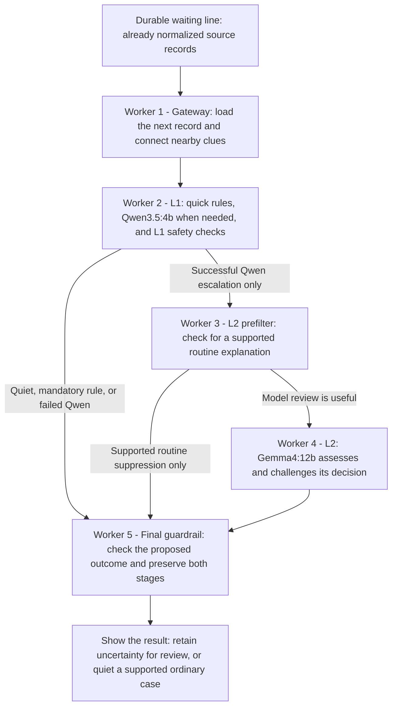

# Five workers: keep each stage moving

The terminal agent's `--l2-final-review` preset and L2-enabled local dashboard use five worker threads.
They work on different events at the same time. **Qwen3.5:4b remains L1;
Gemma4:12b remains L2. Only Qwen's successful model escalations enter L2.**
Both models can be replaced by compatible local models and must remain distinct.

This upgrade followed the stopped 26,002-record checkpoint. That frozen
checkpoint measures one sequential replay worker and must not be presented as a
five-worker or learned-pattern result. Existing/portable installs require an
updated release and explicit L2 configuration.

| Worker | What it does in everyday terms |
|---|---|
| Gateway | Chooses the next saved event, prepares its evidence and keeps review deadlines visible. |
| L1 | Handles clear cases with rules; asks Qwen about unclear ones. It can continue while Gemma investigates another event. |
| L2 prefilter | Independently quiets a supported routine case; passes unresolved L1 escalations, including missing context, to Gemma. |
| L2 | Gives Gemma the original evidence and bounded security context, without Qwen's written opinion; requires a separate challenge pass. |
| Final guardrail | Checks L1-only exits and L2 outcomes. Unsupported or failed L2 decisions leave the original warning visible. Saves exact event bindings. |

The old replay's `L2_CONTEXT_REQUIRED` shortcut retained warnings before Gemma
could read them. That was a routing mismatch with the requested L1/L2 operation.
This pipeline corrects it: the L2 prefilter either suppresses with a
supported reason or passes the escalation to Gemma. Protected risk is still
enforced by the final guardrail after that review. A risky model suppression
cannot override the veto. Legacy sequential comparison tools retain the old
routing explicitly; do not use their numbers as the upgraded pipeline's score.

The independent prefilter keeps the exact five-human-corrections process rule.
It also recognizes a narrow source-confirmed resolution notification: native
Wazuh rule 23502, `Solved`, one named CVE/package/version, low severity, and no
conflicting risk or correlation. It quiets that notification only; it does not
declare the computer safe or rule out prior exploitation. Active, incomplete,
high-risk and unverified lookalikes are not suppressed. Source semantics:
[Wazuh vulnerability events](https://documentation.wazuh.com/current/user-manual/capabilities/vulnerability-detection/how-it-works.html),
[versioned Wazuh rule definitions](https://github.com/wazuh/wazuh/blob/v4.14.10/ruleset/rules/0520-vulnerability-detector_rules.xml).
These rules do not guarantee that most alerts in the current dataset can be
quieted safely; no suppression quota is used. Richer context is evidence to
check, not permission to invent an ordinary explanation.

This means five **stages**, not five copies of either model. Collectors and
other application duties can have additional threads. Ordinary single-brain,
advice-only and native-response modes retain their existing workers. No new
service, runtime dependency or device-action permission is introduced.

## Waiting lines and visible progress

The gateway reads from the existing durable SQLite buffer (10,000 unfinished
records by default). Only one event waits immediately ahead of L1, keeping
urgent selection close to inference. Each later stage has at most 32 queued
jobs. A full line slows the producer instead of discarding events or growing
memory without a limit. A busy Gemma queue can eventually apply backpressure;
separation is not a promise that L1 can run indefinitely without it.

Enter `status` in the source terminal. `pipeline_workers` lists all five names,
whether each is alive/busy, queued jobs, queue capacity, completed jobs, stage
errors, accumulated queue waiting and occupied milliseconds. Occupied time
includes downstream backpressure; it is not pure model compute time. A record
may bypass stages, so completed counts need not be equal. Existing queue totals
include unfinished records; first-stage audit totals and L2 classifications
remain distinct.

`l2-cases` shows the latest 100 cases; the complete records remain in SQLite.
Status totals cover all cases using a small indexed classification scan, and
the event view fetches reviews only for its displayed records. Control actions
look up the exact case directly. Viewing a growing history does not load every
large evidence packet into memory. Quieted cases do not raise overdue-warning
notices; pending and retained cases still get review-deadline notices.

## Local dashboard

Run `arbiter serve --backend ollama --model qwen3.5:4b --l2-model gemma4:12b
--l2-review-seconds 180` with your existing store/IAM/memory paths. For an installed
service, set `llm.l2_model = gemma4:12b` and `llm.l2_review_seconds = 180` in its
existing configuration, alongside backend `ollama` and model `qwen3.5:4b`, then
restart the service. Both models must already be available locally. The two
brains share the same verified loopback inference endpoint, including an owned
private runtime when configured. An absent L2 setting preserves single-brain mode.

Data Sources shows each stage's activity, waiting line, completed work and
errors, plus separate L2 outcomes and [learned-pattern counts](LEARNED-PATTERNS.md).
Live event details show both opinions and the final result; administrators can
choose **Keep this warning visible** to reject a suppression. That also revokes
the matching learned L2 shortcut. Original audit/KPI totals remain L1 totals and
are labelled separately from final L2 classifications. Final quiet cases cannot
enter the guided-response approval/scheduling flow. Existing collection settings,
accounts, evidence and explicit device-action approval gates are preserved.

L1 warnings stay visible while L2 is pending. A human rejection wins even if a
model reply arrives later. Each case is tied to one event. A restart recovers
unfinished records and reuses a completed durable L1 verdict instead of asking
Qwen twice. A saved L2 answer is checked again against the current final policy
before reuse. Shutdown waits for active workers before closing their stores;
it can wait for the bounded outstanding model call. No model request grants
permission for a network block, process termination or command.

## What we verified, and what to measure next

Controlled model replies with real queues and temporary stores demonstrated
that L1 progresses while L2 is blocked. Tests also cover final safety vetoes,
model/prefilter/finalizer failures, rejection during inference, pending review
deadlines, model changes, shutdown and restart recovery. These are software
checks, not a public-data accuracy result or a real-GPU speed benchmark.

Five workers do not guarantee a fivefold speedup. Qwen and Gemma share a GPU;
the local inference server may serialize work or reload model weights. Richer
L2 context can increase review time or route more cases to Gemma. Measure the
same frozen records sequentially and through this pipeline, record model
loading, queue delay, per-stage median/95th-percentile latency and throughput,
and check decision quality alongside speed. Then test attack-containing
timelines, ordinary lookalikes and bursts with persistent scoped history.

Start commands: [two-brain setup](TWO-BRAIN-SETUP.md). Context boundaries:
[L2 security context](L2-CONTEXT.md). Historical results stay separate.
