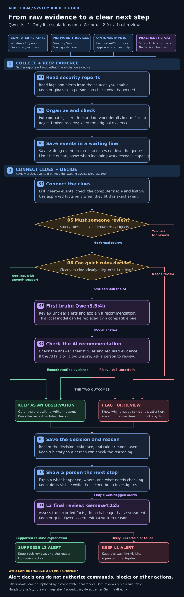
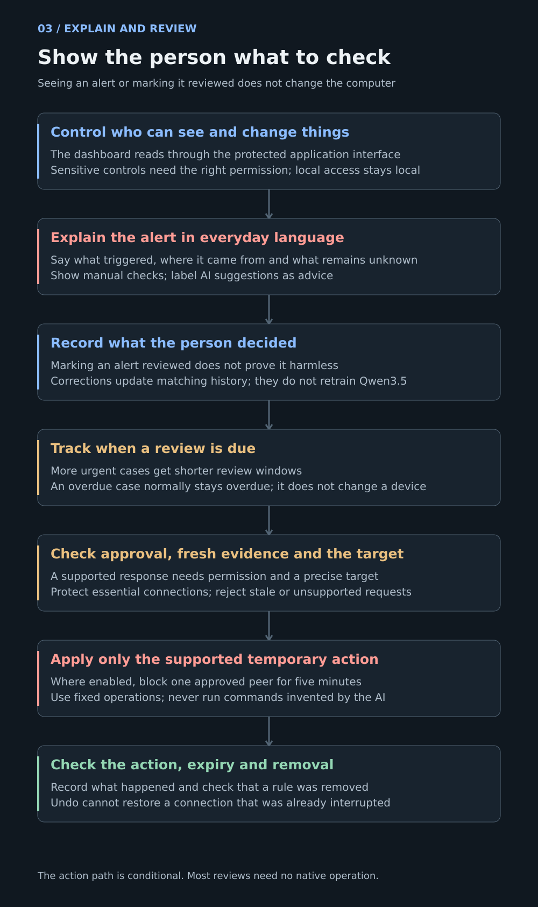
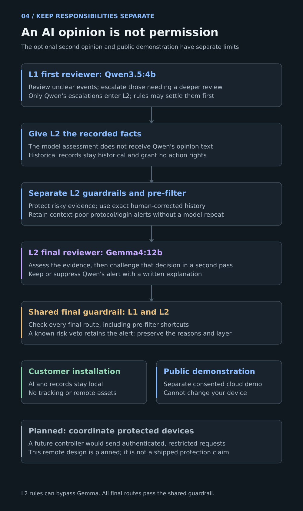

# Arbiter architecture — still-diagram edition

These static diagrams contain the same labels as the
[animated walkthrough](../ARCHITECTURE-WALKTHROUGH.md). No motion is required to
understand the system. Follow the linked explanations for the full text equivalent.

Each box explains its job in everyday language. **Qwen3.5:4b is L1;
Gemma4:12b is the L2 model. Only Qwen's escalations enter the separate L2 rules;
Gemma is called when useful.** Both stages use a shared final guardrail. Either model can be replaced with a compatible
local model. Ollama is the current
local runner, not the name of the model. See the [model and runner explanation](../ARCHITECTURE-WALKTHROUGH.md#qwen35-replacement-models-and-ollama).

## 1–2. Complete intake and triage flow

[Read the intake explanation](../ARCHITECTURE-WALKTHROUGH.md#1-intake-preserve-the-evidence).
[Read the triage explanation](../ARCHITECTURE-WALKTHROUGH.md#2-triage-decide-with-evidence).

## 3. Review and response

[Read the review and response explanation](../ARCHITECTURE-WALKTHROUGH.md#3-review-explain-before-asking-for-action).

## 4. System boundaries

[Read the boundaries explanation](../ARCHITECTURE-WALKTHROUGH.md#4-boundaries-keep-reasoning-and-authority-separate).
