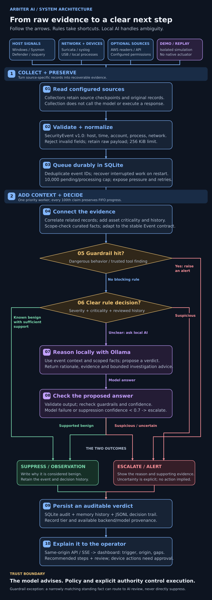
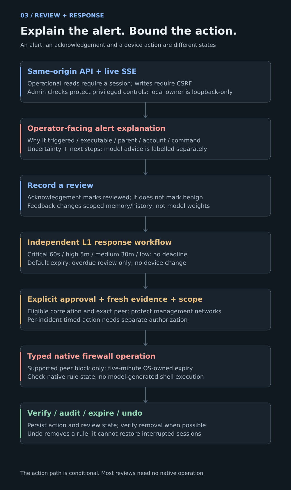
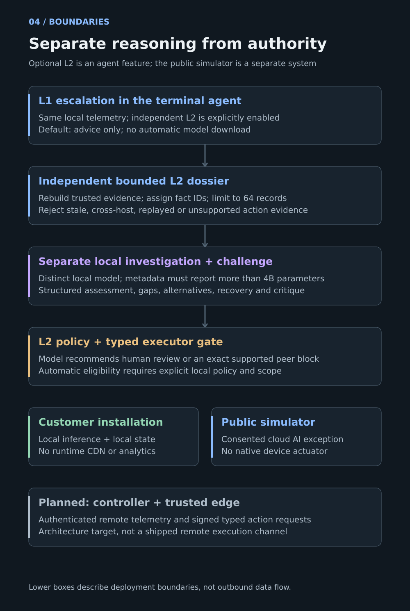

# Arbiter architecture — still-diagram edition

These static diagrams contain the same labels as the
[animated walkthrough](../ARCHITECTURE-WALKTHROUGH.md). No motion is required to
understand the system. Follow the linked explanations for the full text equivalent.

## 1–2. Complete intake and triage flow

[Read the intake explanation](../ARCHITECTURE-WALKTHROUGH.md#1-intake-preserve-the-evidence).
[Read the triage explanation](../ARCHITECTURE-WALKTHROUGH.md#2-triage-decide-with-evidence).

## 3. Review and response

[Read the review and response explanation](../ARCHITECTURE-WALKTHROUGH.md#3-review-explain-before-asking-for-action).

## 4. System boundaries

[Read the boundaries explanation](../ARCHITECTURE-WALKTHROUGH.md#4-boundaries-keep-reasoning-and-authority-separate).
